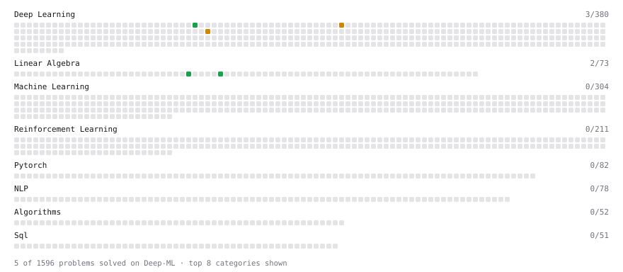

# Deep-ML

My machine learning practice from [Deep-ML](https://www.deep-ml.com). Every solution here was written by hand.

**8** solved · 5 problems · 0 labs · 3 math

[**Browse the interactive portfolio**](https://myles-alexander.github.io/deep-ml/) to replay this filling in over time.

## Problems

| | Difficulty | Solved | |
| --- | --- | --- | --- |
| [Dot Product Calculator](https://www.deep-ml.com/problems/83) | easy | 2026-09-22 | [solution](problems/0083-dot-product-calculator) |
| [Implement a Simple Residual Block with Shortcut Connection](https://www.deep-ml.com/problems/113) | easy | 2026-10-17 | [solution](problems/0113-implement-a-simple-residual-block-with-shortcut-connection) |
| [Vector Element-wise Sum](https://www.deep-ml.com/problems/121) | easy | 2026-09-22 | [solution](problems/0121-vector-element-wise-sum) |
| [Implement Position-wise Feed-Forward Block with Residual and Dropout](https://www.deep-ml.com/problems/178) | medium | 2026-10-17 | [solution](problems/0178-implement-position-wise-feed-forward-block-with-residual-and-dropout) |
| [Pre-Norm vs Post-Norm Transformer Block](https://www.deep-ml.com/problems/408) | medium | 2026-10-18 | [solution](problems/0408-pre-norm-vs-post-norm-transformer-block) |

## Math

| | Difficulty | Solved | |
| --- | --- | --- | --- |
| [Matrix Basics](https://www.deep-ml.com/math-problems/9) | easy | 2026-09-22 | [solution](math/0009-matrix-basics) |
| [Vector Operations](https://www.deep-ml.com/math-problems/7) | easy | 2026-09-22 | [solution](math/0007-vector-operations) |
| [Vector Norms and Linear Independence](https://www.deep-ml.com/math-problems/8) | medium | 2026-09-22 | [solution](math/0008-vector-norms-and-linear-independence) |

---

_This file is regenerated by Deep-ML on every push._
